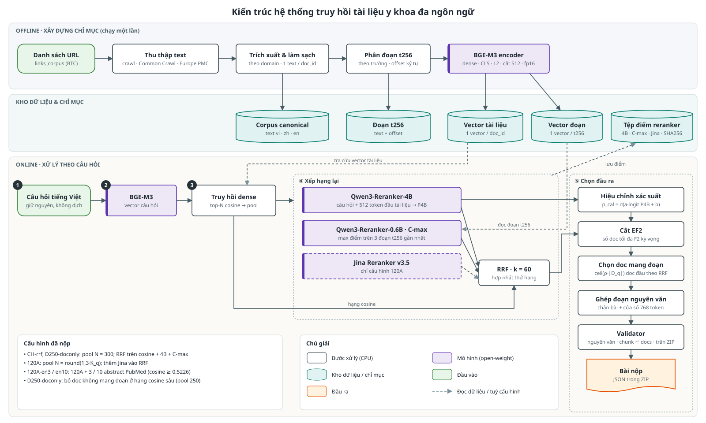

# Thông tin chung

| Mục | Nội dung |
|---|---|
| Đội | Trần Xuân Vũ |
| Mã nguồn | https://github.com/TranVu2005/r2ai-stage3-submission |
| Dữ liệu | https://drive.google.com/drive/folders/1NUw099da7rR4zd_j3pg_acTUHjfAH09B (gói và cách dùng ở mục 2.5) |
| Bài nộp private | 5 tệp, liệt kê ở mục 1.7 |

Bộ hồ sơ gồm:

| Tệp | Nội dung |
|---|---|
| `docs/THUYET_MINH.pdf` (tài liệu này) | Tổng quan hệ thống, dữ liệu, mô hình, mã nguồn, tái hiện |
| `README.md` (gốc repo) | Cài đặt, tải dữ liệu, lệnh tái hiện |
| `DATA.md` | Nguồn dữ liệu, gói chia sẻ, dung lượng, cách giải nén |
| `MODELS.md` | Mô hình, revision, cấu hình suy luận, instruction của reranker |
| `docs/REPRODUCE.md` | Hướng dẫn tái hiện cho người chấm: clone, tải dữ liệu, chạy, kết quả mong đợi, lỗi thường gặp |
| `docs/ARCHITECTURE.md` | Bản đồ mã nguồn: module → chức năng |

# 1. Tổng quan hệ thống

## 1.1 Bài toán

* **Đầu vào:** câu hỏi y khoa tiếng Việt và tập URL tài liệu tiếng Việt, tiếng Trung, tiếng Anh do BTC cung cấp (`links_corpus_vi_en_zh.parquet`, dataset `AIGuruTinix/ViBioMIR`).
* **Đầu ra:** với mỗi câu hỏi, (1) danh sách `doc_id` liên quan (`relevant_docs`) và (2) các đoạn nội dung trích nguyên văn từ chính các tài liệu đó (`relevant_chunks`).
* **Định dạng bài nộp:** một tệp JSON trong ZIP, mỗi phần tử `{id, relevant_docs, relevant_chunks[{doc_id, chunk_text}]}`.

## 1.2 Phương pháp

Hệ thống là một pipeline **truy hồi dense → xếp hạng lại bằng nhiều reranker → chọn số tài liệu theo F2 kỳ vọng → trích đoạn nguyên văn**. Đặc điểm:

* Không huấn luyện hay fine-tune mô hình; chỉ dùng mô hình open-weight công khai (lớn nhất 4B tham số).
* Không dùng LLM sinh văn bản; mọi đoạn trả về là chuỗi con nguyên văn của tài liệu.
* Bước dựng bài nộp (từ các tệp điểm đã lưu đến ZIP) chạy trên CPU, tất định, và đã được kiểm dựng lại **trùng từng byte** cho cả 5 bài nộp private.

## 1.3 Kiến trúc và các thành phần

| Thành phần | Chức năng | Mã nguồn |
|---|---|---|
| Thu thập dữ liệu | Lấy text của các URL trong corpus BTC | `src/vicrawl`, `src/r2ai/crawl` |
| Trích xuất, làm sạch | Tách tiêu đề / câu hỏi / trả lời / thân bài; chọn một bản text cho mỗi `doc_id` | `src/r2ai/extract`, `src/r2ai/canonical` |
| Chỉ mục | Phân đoạn t256; nhúng BGE-M3 mức tài liệu và mức đoạn | `src/r2ai/index` |
| Truy hồi | Nhúng câu hỏi, lấy pool ứng viên theo cosine | `src/r2ai/s29`, `src/r2ai/s37` |
| Xếp hạng lại | Chấm điểm bằng Qwen3-Reranker-4B, C-max (Qwen3-Reranker-0.6B), Jina; hợp nhất RRF | `src/r2ai/s31`, `s32`, `s35`, `s37`, `notebooks/s36-kaggle-4b-final.ipynb` |
| Chọn đầu ra | Hiệu chỉnh xác suất, cắt EF2, chọn tài liệu mang đoạn | `src/r2ai/s36` |
| Ghép đoạn, kiểm tra | Tạo `chunk_text` nguyên văn, validator, đóng gói ZIP | `src/r2ai/s38` |
| Điều phối | Dựng lại từng bài nộp và kiểm trùng byte với tệp đã nộp | `src/r2ai/reproduce.py`, `scripts/reproduce_*`, `src/r2ai/release.py` |

## 1.4 Luồng xử lý



Tên module dạng `sNN` (`r2ai.s36`, `scripts/s45/` …) là số đợt phát triển, giữ nguyên để không đổi đường import và config đã ghim; bảng ánh xạ module → chức năng ở `docs/ARCHITECTURE.md`.

1. **Chỉ mục (offline, chạy một lần):** text tài liệu → làm sạch → vector BGE-M3 mức tài liệu (512 token đầu của tiêu đề + thân bài) và vector cho từng đoạn t256.
2. **Truy hồi:** câu hỏi tiếng Việt (giữ nguyên, không dịch) → vector BGE-M3 → lấy N tài liệu có cosine cao nhất làm pool ứng viên.
3. **Xếp hạng lại:** mỗi cặp (câu hỏi, tài liệu) trong pool được chấm bởi các reranker; thứ hạng cuối là hợp nhất RRF.
4. **Chọn đầu ra:** quyết định số tài liệu trả về cho từng câu hỏi, chọn tài liệu nào kèm đoạn trích, ghép đoạn nguyên văn, kiểm tra và đóng gói.

## 1.5 Xây dựng chỉ mục và truy hồi

* **Vector tài liệu:** BGE-M3 dense, đầu vào `title + body`, cắt 512 token, pooling CLS, chuẩn hoá L2, lưu fp16.
* **Đoạn t256:** cắt theo trường (tiêu đề / câu hỏi / trả lời / thân bài) và đoạn văn, tối đa 256 token, lưu offset ký tự để trích nguyên văn; mỗi đoạn có vector BGE-M3 riêng.
* **Pool ứng viên:** tích vô hướng giữa vector câu hỏi và vector tài liệu trên toàn corpus. Cỡ pool:
  * cấu hình CH-rrf, D250-doconly: 300 tài liệu / câu hỏi;
  * cấu hình 120A: round(1,3 · K_q) tài liệu, trong đó K_q là số tài liệu mà hệ thống thế hệ trước của đội (P1) đã chọn cho câu hỏi đó.
* Khi điểm bằng nhau, thứ tự theo vị trí trong corpus (tất định).

## 1.6 Xếp hạng lại và chọn kết quả đầu ra

**Xếp hạng lại.** Mỗi cặp trong pool được chấm bởi:

* **Qwen3-Reranker-4B:** xác suất "liên quan" P4B, đầu vào là câu hỏi + 512 token đầu của tài liệu.
* **C-max:** Qwen3-Reranker-0.6B chấm 3 đoạn t256 gần câu hỏi nhất (theo cosine) của tài liệu, lấy điểm lớn nhất. Thành phần này bắt các tài liệu có đoạn trả lời nằm sâu trong bài.
* **Jina Reranker v3.5** (chỉ cấu hình 120A).
* **Hợp nhất:** Reciprocal Rank Fusion, k = 60, trên các thứ hạng cosine, 4B, C-max (và Jina).

**Chọn số tài liệu (cắt EF2).**

* Xác suất hiệu chỉnh: p_cal = σ(a · logit(P4B) + b).
* Số tài liệu gold kỳ vọng của câu hỏi: G_q = s · (Σ p_cal trên pool + phần đuôi ước lượng ngoài pool).
* Đi theo thứ tự RRF, chọn k tài liệu đầu sao cho F2 kỳ vọng 5 · Σ_{i≤k} p_cal,i / (4 · G_q + k) lớn nhất (k ≥ 20).
* Các hằng số a, b, s và ngưỡng khác là **tham số toàn cục**, chọn trong quá trình phát triển và ghim cố định trong tệp config; không dùng nhãn của từng câu hỏi.

**Chọn và ghép đoạn trích.**

* Tài liệu mang đoạn trích (carrier): ceil(ρ · |D_q|) tài liệu đầu theo RRF của mỗi câu hỏi, ρ chọn sao cho tổng số carrier cố định (146,29 / câu hỏi trung bình).
* Nội dung đoạn: thân bài nguyên văn; nếu thân bài dài hơn T = 1.536 token thì thêm một cửa sổ 768 token quanh đoạn t256 có điểm 0.6B cao nhất.
* Nếu ZIP vượt trần 102,6 MB thì giảm T tự động.

**Validator** (chạy trước khi đóng gói): đủ mọi câu hỏi, `doc_id` thuộc corpus, `chunk_text` là chuỗi con nguyên văn của tài liệu, mọi đoạn thuộc tài liệu có trong `relevant_docs`, tối đa 2 đoạn / tài liệu, ZIP dưới trần dung lượng.

## 1.7 Các bài nộp private

| Tệp nộp | Cấu hình | Kích thước (B) |
|---|---|---:|
| `1_120A.zip` | 120A | 99.417.831 |
| `2_D250doconly.zip` | D250-doconly | 100.605.161 |
| `3_CHrrf.zip` | CH-rrf | 100.651.136 |
| `4_120A-en3.zip` | 120A + 3 tài liệu tiếng Anh | 100.813.214 |
| `5_120A-en10.zip` | 120A + 10 tài liệu tiếng Anh | 100.847.665 |

Cả 5 tệp có trong thư mục `submissions/` của link dữ liệu và trong GitHub Release `v1.0` của repo.

Khác biệt giữa các cấu hình:

| | CH-rrf | D250-doconly | 120A | 120A-en3 / en10 |
|---|---|---|---|---|
| Pool | top-300 cosine | top-300 cosine | top-round(1,3·K_q) | như 120A |
| Nguồn RRF | cosine, 4B, C-max | như CH-rrf | cosine, 4B, C-max, Jina | như 120A |
| Số tài liệu | cắt EF2 | cắt EF2 trên pool top-250, hợp với các tài liệu mang đoạn của CH-rrf | cắt EF2 | 120A + 3 / 10 abstract tiếng Anh (cosine ≥ 0,5226) |
| Đoạn trích | thân bài + cửa sổ 768, T = 1.536 | trùng CH-rrf | thân bài + cửa sổ 768, T = 1.536 | 120A + abstract nguyên văn cho 3 tài liệu tiếng Anh đầu |

# 2. Dữ liệu

## 2.1 Nguồn dữ liệu

Chỉ dùng text của chính các URL trong corpus BTC. Không thêm tài liệu ngoài danh sách, không có text dịch hay sinh.

| Nhóm | Cách lấy text | Số tài liệu |
|---|---|---:|
| Tiếng Việt, tiếng Trung (đa số) | Crawl trực tiếp theo URL; Common Crawl (WARC, tra theo index, lưu provenance từng tài liệu) | 887.151 (corpus canonical) |
| 120ask (tiếng Trung, hỏi đáp) | Crawl trực tiếp từ máy chủ đặt ở nước ngoài | 73.000 (9 segment, crawl từ 73.001 URL chưa có text). Corpus BTC có 98.160 URL 120ask: 25.151 đã có text trong corpus canonical, 9 không lấy được text |
| Pharmacity | Theo hướng dẫn BTC (19/10): lấy từ `www.pharmacity.vn/<slug>.htm`, giữ nguyên `doc_id` | 979 |
| Tiếng Anh (PubMed) | Abstract qua Europe PMC theo PMID trong URL | 239.771 (chỉ dùng cho 120A-en3/en10) |

## 2.2 Thu thập và làm sạch

* Trích xuất theo domain (bộ chọn riêng cho các trang lớn: tiêu đề / câu hỏi / trả lời / thân bài); trang khác dùng trafilatura.
* Chỉ chuẩn hoá khoảng trắng; không sửa nội dung.
* Mỗi `doc_id` giữ đúng một bản text; quy tắc chọn khi có nhiều nguồn ghi trong `decisions.parquet`.
* Kiểm toàn bộ: `doc_id` thuộc corpus BTC; đoạn là chuỗi con nguyên văn; vector khớp text (79 tệp đầu vào ghim trong `configs/s41-newq-pins.json`).

## 2.3 Phân đoạn văn bản

* Đoạn chỉ mục t256 (mục 1.5), lưu kèm offset ký tự.
* Đoạn trong bài nộp: thân bài nguyên văn, cộng một cửa sổ 768 token cho bài dài (mục 1.6).

## 2.4 Lưu ý về tái hiện dữ liệu

Trang web thay đổi theo thời gian nên crawl lại **không** cho kết quả trùng byte. Điểm xuất phát tái hiện là **corpus canonical đã trích xuất** trong gói chia sẻ. Mã crawl và trích xuất có trong mã nguồn để đối chiếu phương pháp.

## 2.5 Truy cập dữ liệu

Thư mục dữ liệu: https://drive.google.com/drive/folders/1NUw099da7rR4zd_j3pg_acTUHjfAH09B. Trong đó: `data/` (8 gói và tệp `.SHA256SUMS` của từng gói), `submissions/` (5 ZIP bài nộp), `SHA256SUMS`, `data-manifest.csv`, `README_DATA.txt`.

| Gói (trong `data/` của thư mục chia sẻ) | Nội dung | Dung lượng | Cần cho |
|---|---|---:|---|
| `r2ai-data-canonical.tar` | corpus canonical (text, đoạn, vector) | 18,1 GB | mọi bài nộp |
| `r2ai-data-120ask.tar` | segment 120ask | 1,07 GB | mọi bài nộp |
| `r2ai-runs-inputs.tar` | vector tài liệu và câu hỏi, Pharmacity | 2,2 GB | mọi bài nộp |
| `r2ai-runs-scores.tar` | tệp điểm 4B, C-max, Jina cho các cặp trong pool | 0,61 GB | mọi bài nộp (dựng lại không cần GPU) |
| `r2ai-runs-meta.tar` | manifest, tham số hiệu chỉnh | 34 MB | mọi bài nộp |
| `r2ai-s49-inputs.tar` | `kq_counts.parquet`, `p1_chunks.parquet`, `p1_chunks_chrrf.parquet` | 10 MB | 120A, 120A-en3/en10, CH-rrf |
| `r2ai-data-en-pubmed.tar` | abstract PubMed + vector | 1,19 GB | 120A-en3/en10 |
| `r2ai-submissions.tar` | 5 ZIP private + bản tham chiếu | 0,70 GB | CH-rrf, D250-doconly (mốc so sánh thứ tự tài liệu) |

Cách dùng (đường dẫn trong gói là `data/…`, `out/runs/…`, `submissions/…`, nên mọi gói giải nén vào cùng một thư mục gốc):

```bash
sha256sum -c SHA256SUMS --ignore-missing      # kiểm toàn vẹn các tệp đã tải
export R2AI_ROOT=/duong/dan/r2ai-root
mkdir -p "$R2AI_ROOT"
for f in data/r2ai-*.tar; do tar -xf "$f" -C "$R2AI_ROOT"; done   # Git Bash, đường dẫn có ổ đĩa: thêm --force-local
```

# 3. Mô hình sử dụng

Mọi mô hình là open-weight, dùng nguyên checkpoint công khai (không fine-tune, không checkpoint riêng của đội), tải từ Hugging Face theo revision cố định.

| Mô hình | Revision | Tham số | Vai trò | Cấu hình suy luận | Giấy phép |
|---|---|---:|---|---|---|
| `BAAI/bge-m3` | `5617a9f6…` | 568M | Nhúng tài liệu, đoạn, câu hỏi; tokenizer đếm token | dense CLS, L2, cắt 512, fp16 | MIT |
| `Qwen/Qwen3-Reranker-4B` | `22e68366…` | 4B | Điểm tài liệu P4B; cơ sở hiệu chỉnh p_cal | fp16, cắt 512 token, 2×T4 (Kaggle) | Apache-2.0 |
| `Qwen/Qwen3-Reranker-0.6B` | `e61197ed…` | 0,6B | C-max (điểm đoạn), chọn cửa sổ 768 | bf16, đoạn t256, top-3 đoạn / tài liệu | Apache-2.0 |
| `jinaai/jina-reranker-v3.5` | `e8a93f33…` | 0,6B | Nguồn RRF thứ tư (chỉ 120A) | listwise, bf16, khối ≤ 10 tài liệu xáo theo seed `query_id`, tài liệu cắt 512 token | CC-BY-NC-4.0 |

* Revision đầy đủ (40 ký tự) và instruction nguyên văn của các reranker Qwen3: `MODELS.md`.
* Tải: `hf download <model_id> --revision <revision>`.
* Không dùng API hay mô hình đóng.

# 4. Mã nguồn

## 4.1 Phạm vi

Mã nguồn đầy đủ ở https://github.com/TranVu2005/r2ai-stage3-submission: thu thập và trích xuất dữ liệu, dựng corpus, chỉ mục, truy hồi, chấm reranker, chọn đầu ra, ghép đoạn, validator, đóng gói và các script tái hiện.

* Repo chỉ chứa mã và tài liệu cần cho bài nộp và việc tái hiện; đường dẫn máy thay bằng biến môi trường (mẫu `configs/paths.example.env`).
* Một điểm vào cho tái hiện: `python -m r2ai.reproduce`.
* Bản đồ module → chức năng: `docs/ARCHITECTURE.md`.

## 4.2 Môi trường và phụ thuộc

* Python 3.12 (`requires-python >= 3.11, < 3.14`).
* Phụ thuộc khai báo trong `pyproject.toml` (extra `[reproduce]` cho tái hiện); phiên bản khoá đầy đủ ở `configs/environment.constraints.txt`.
* Các gói quyết định byte của ZIP: pyarrow 25.0.1, numpy 2.5.3, pandas 3.0.6, polars 1.44.2, transformers 5.18.0, tokenizers 0.23.2.
* torch 2.11.0+cu128: chỉ cần khi chấm reranker hoặc nhúng lại.

## 4.3 Tệp cấu hình

| Cấu hình | Tệp config | Tệp ghim đầu vào |
|---|---|---|
| CH-rrf | `configs/s41-private-final.json` | `configs/s41-newq-pins.json` |
| D250-doconly | CH-rrf + `scripts/s45/public_rebuild.py --depth 250` + `scripts/s45/doc_only.py` | như CH-rrf |
| 120A | `configs/s36-handoff-120A-p4b-v3.json` | `configs/s36-handoff-s30-manifest.json` |
| 120A-en3 / en10 | 120A + `scripts/s48/hedge_on_zip.py` | như 120A + gói `en-pubmed` |

# 5. Hướng dẫn cài đặt và tái hiện

Hướng dẫn từng bước cho người chấm, kèm lệnh kiểm sau mỗi bước, kết quả mong đợi và lỗi thường gặp: `docs/REPRODUCE.md`. Lệnh đầy đủ và các tuỳ chọn: `README.md`. Tóm tắt dưới đây.

## 5.1 Yêu cầu môi trường

| Mức | Phần cứng | Thời gian |
|---|---|---|
| A. Dựng lại bài nộp từ tệp điểm | CPU, RAM ≥ 16 GB, ổ trống ≥ 60 GB | khoảng 4 giờ 25 phút cho 5 tệp nộp (`--all`) |
| B. Chấm lại reranker | GPU: 2×T4 (Kaggle) cho 4B; GPU ≥ 6 GB cho C-max | 4B khoảng 15 giờ / 360.000 cặp; C-max khoảng 10 giờ |

Đã kiểm trên Windows (Git Bash); Linux chưa kiểm.

## 5.2 Cài đặt

```bash
git clone https://github.com/TranVu2005/r2ai-stage3-submission r2ai-stage3 && cd r2ai-stage3
python -m venv .venv && source .venv/bin/activate      # Windows (Git Bash): source .venv/Scripts/activate
pip install -e ".[reproduce]" -c configs/environment.constraints.txt \
    --extra-index-url https://download.pytorch.org/whl/cu128
export R2AI_ROOT=/duong/dan/r2ai-root                   # thư mục đã giải nén các gói (mục 2.5)
export HF_HOME=/duong/dan/hf_home HF_HUB_OFFLINE=1      # mô hình theo revision ở MODELS.md
```

## 5.3 Chạy lại

**Mức A: dựng lại các bài nộp private** (chỉ CPU):

```bash
python -m r2ai.reproduce --all                  # 5 tệp nộp, in bảng PASS/FAIL (chỉ cần CPU)
python -m r2ai.reproduce ch-rrf d250-doconly    # hoặc từng tệp: 120a, 120a-en3, 120a-en10; kiểm thêm: 120a-nop1
python -m r2ai.reproduce --list                 # các mục dựng được
```

Lệnh tự so mỗi ZIP đầu ra với tệp đã nộp (mục 1.7) và chỉ báo PASS khi ZIP do chính lần chạy này ghi ra và trùng từng byte; mã thoát khác 0 nếu có bài FAIL. Bên dưới, lệnh gọi `scripts/reproduce_public.sh` (CH-rrf, D250-doconly), và `scripts/reproduce_120a.sh` (120A, en3, en10, nop1).

**Mức B: chấm lại reranker:**

* 4B: chạy `notebooks/s36-kaggle-4b-final.ipynb` trên Kaggle (2×T4) với tệp cặp xuất từ bước truy hồi, rồi nạp điểm về.
* C-max: `scripts/s32/run_score.ps1`, `scripts/s37/run_cmax.ps1` (GPU máy).

# Phụ lục: thuật ngữ

| Thuật ngữ | Nghĩa |
|---|---|
| Pool | Tập tài liệu ứng viên của một câu hỏi, lấy theo cosine BGE-M3 |
| P4B | Xác suất liên quan do Qwen3-Reranker-4B chấm |
| C-max | Điểm lớn nhất của Qwen3-Reranker-0.6B trên 3 đoạn t256 gần câu hỏi nhất |
| RRF | Reciprocal Rank Fusion: điểm = Σ 1 / (k + hạng) qua các nguồn |
| p_cal | Xác suất đã hiệu chỉnh từ P4B |
| EF2 | Quy tắc chọn số tài liệu sao cho F2 kỳ vọng lớn nhất |
| Carrier | Tài liệu được kèm đoạn trích trong `relevant_chunks` |
| t256 | Đoạn chỉ mục dài tối đa 256 token BGE-M3 |
| CH-rrf, D250-doconly, 120A | Tên các cấu hình đã nộp (mục 1.7) |
| P1 | Hệ thống thế hệ trước của đội (18/10/2026) |
